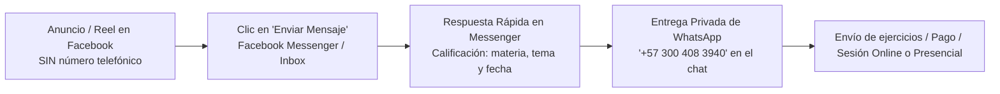

# Plan de Campaña en Facebook — Asesorías en Ingeniería (Últimas Semanas de Estudio)

**Marca Comercial**: **Asesorías en Ingeniería**  
**Director Académico**: Ing. Oscar Fernando Valencia — Ingeniero Civil, Especialista en Estructuras & Desarrollador  
**Canal Único de Entrada en Anuncios**: **Facebook (Messenger / Inbox / Comentarios)**  
**Canal de Cierre Privado**: WhatsApp `(+57) 300 408 3940` *(entregado únicamente por chat privado de Facebook al estudiante/interesado)*  
**Temporalidad Crítica**: Campaña de urgencia académica para aprovechar las **últimas semanas del semestre / año escolar** (parciales finales, entregas de proyectos, habilitaciones y refuerzos).

---

## 1. Arquitectura del Embudo (Facebook-First -> WhatsApp Privado)

### ¿Por qué este embudo?
1. **Protección de privacidad**: Evita exponer el número personal en anuncios públicos masivos.
2. **Mayor conversión en Meta Ads**: Los anuncios con objetivo **"Interacción -> Mensajes (Messenger)"** tienen menor costo por conversación iniciada en campañas educativas locales y permiten responder al instante con el guion de cierre.
3. **Filtro de calidad**: Solo pasan a WhatsApp estudiantes e interesados reales que ya informaron su materia y fecha de examen/entrega.

---

## 2. Segmentación y Configuración Recomendada en Meta Ads (Facebook)

- **Objetivo de Campaña**: `Interacción` $\rightarrow$ `Apps de mensajería` $\rightarrow$ **Solo Messenger (Página de Facebook: Asesorías en Ingeniería)**.
- **Ubicaciones**: Feed de Facebook, Historias de Facebook, Reels de Facebook y Marketplace.
- **Conjuntos de Anuncios (2 frentes simultáneos)**:

| Conjunto de Anuncios | Público Objetivo | Ubicación Geográfica | Creativos Asignados |
| :--- | :--- | :--- | :--- |
| **A. Universitarios y Cierre de Semestre (17–28 años)** | Estudiantes universitarios (Ingeniería Civil, Mecánica, Industrial, Sistemas, Arquitectura) e intereses en Cálculo, Física, Python, AutoCAD, UdeA, UNAL, EAFIT, UPB, ITM, EIA, Poli. | Área Metropolitana del Valle de Aburrá + Oriente Antioqueño (o Colombia para modalidad Online 100%). | `Video_01_Reel_Ultimas_Semanas_Salva_Tu_Semestre_9x16.mp4`, `Aviso_01_Cierre_Semestre_Parciales_Finales_4x5.png`, `Aviso_03_Ingenieria_Civil_Estructuras_NSR10_4x5.png`, `Aviso_04_Programacion_Python_MATLAB_Web_1x1.png` |
| **B. Padres de Familia y Colegio (34–55 años)** | Padres de adolescentes (13–18 años) interesados en educación secundaria, refuerzo escolar, matemáticas y física para salvar el año escolar. | Medellín, Envigado, Sabaneta, Bello, Itagüí, Rionegro, Santa Elena y Guarne. | `Aviso_02_Matematicas_Calculo_Fisica_1x1.png`, `Aviso_05_Asesoria_Expres_Ultimos_Dias_4x5.png`, `Video_03_Feed_Asesorias_en_Ingenieria_1x1.mp4` |

- **Presupuesto Sugerido de Arranque**: $\$15,000\text{ a }\$25,000\text{ COP/día}$ durante las últimas 3 a 4 semanas de estudio.

---

## 3. Plan Orgánico Diario en Facebook (Costo $0)

1. **Configuración de Página de Facebook "Asesorías en Ingeniería"**:
   - Subir como **Foto de Perfil**: [`Logo_Perfil_Cuadrado_Facebook_Asesorias_en_Ingenieria.jpg`](file:///home/v1rr3eor/IAs/projects/publicidad-asesorias/identidad_marca/Logo_Perfil_Cuadrado_Facebook_Asesorias_en_Ingenieria.jpg).
   - Subir como **Foto de Portada**: [`Banner_Portada_Facebook_Asesorias_en_Ingenieria.png`](file:///home/v1rr3eor/IAs/projects/publicidad-asesorias/identidad_marca/Banner_Portada_Facebook_Asesorias_en_Ingenieria.png).
   - Activar el botón principal de la página: **"Enviar mensaje"** (Messenger).
2. **Facebook Marketplace (Servicios Educativos)**:
   - Publicar 3 anuncios gratuitos distintos usando `Aviso_01`, `Aviso_03` y `Aviso_04` con títulos como *"Clases Particulares de Cálculo, Matemáticas y Física - Cierre de Semestre"* y *"Asesorías en Ingeniería Civil, Estructuras y Python"*.
3. **Grupos Universitarios y Comunitarios de Facebook**:
   - Publicar `Video_01`, `Video_02` y `Aviso_05` en grupos de estudiantes universitarios de Medellín/Antioquia, grupos de vecinos de Oriente Antioqueño y clasificados locales (máximo 3–5 grupos por día con textos variados para evitar bloqueos).
4. **Historias de Facebook (Diario)**:
   - Alternar `Historia_Facebook_Reels_01_Ultimas_Semanas_9x16.png` y `Historia_Facebook_Reels_02_Ingenieria_Programacion_9x16.png` en las historias de la página y perfil personal.
