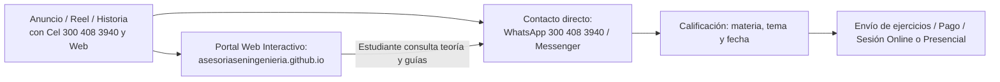

# Plan de Campaña en Facebook — Asesorías en Ingeniería

**Marca Comercial**: **Asesorías en Ingeniería**  
**Director Académico**: Ing. Oscar Fernando Valencia — Ingeniero Civil, Especialista en Estructuras & Desarrollador  
**Celular / WhatsApp**: **`300 408 3940`** (`(+57) 300 408 3940`)  
**Portal Educativo Interactivo**: **`https://asesoriaseningenieria.github.io`**  
**Canales de Entrada**: WhatsApp `300 408 3940`, Web `asesoriaseningenieria.github.io` y Facebook Messenger / Inbox  
**Temporalidad Crítica**: Campaña continua y de urgencia académica para aprovechar las **últimas semanas del semestre / año escolar** (parciales finales, entregas de proyectos, habilitaciones y refuerzos).

---

## 1. Arquitectura del Embudo (Anuncio -> Web Interactiva / WhatsApp / Messenger)

---

## 2. Segmentación y Configuración Recomendada en Meta Ads (Facebook)

- **Objetivo de Campaña**: `Interacción` $\rightarrow$ `Apps de mensajería` (**WhatsApp `300 408 3940` y Messenger**) o `Tráfico` hacia `https://asesoriaseningenieria.github.io`.
- **Ubicaciones**: Feed de Facebook, Historias de Facebook, Reels de Facebook y Marketplace.
- **Conjuntos de Anuncios (2 frentes simultáneos)**:

| Conjunto de Anuncios | Público Objetivo | Ubicación Geográfica | Creativos Asignados |
| :--- | :--- | :--- | :--- |
| **A. Universitarios y Cierre de Semestre (17–28 años)** | Estudiantes universitarios (Ingeniería Civil, Mecánica, Industrial, Sistemas, Arquitectura) e intereses en Cálculo, Física, Estática, Python, AutoCAD, UdeA, UNAL, EAFIT, UPB, ITM, EIA, Poli. | Área Metropolitana del Valle de Aburrá + Oriente Antioqueño (y Colombia / LATAM para modalidad Online 100%). | `Aviso_06`, `Aviso_07`, `Aviso_08`, `Aviso_09`, `Aviso_10` (EN), `Aviso_11`, `Aviso_14`, `Video_01`, `Video_02`, `Video_04` |
| **B. Padres de Familia y Colegio (34–55 años)** | Padres de adolescentes (13–18 años) interesados en educación secundaria, refuerzo escolar, matemáticas y física para salvar el año escolar. | Medellín, Envigado, Sabaneta, Bello, Itagüí, Rionegro, Santa Elena y Guarne. | `Aviso_02`, `Aviso_05`, `Aviso_13`, `Historia_03`, `Video_03` |

- **Presupuesto Sugerido de Arranque**: $\$15,000\text{ a }\$25,000\text{ COP/día}$ durante las últimas semanas de estudio.

---

## 3. Plan Orgánico Diario en Facebook (Costo $0)

1. **Configuración de Página de Facebook "Asesorías en Ingeniería"**:
   - Subir como **Foto de Perfil**: [`Logo_Perfil_Cuadrado_Facebook_Asesorias_en_Ingenieria.jpg`](../identidad_marca/Logo_Perfil_Cuadrado_Facebook_Asesorias_en_Ingenieria.jpg).
   - Subir como **Foto de Portada**: [`Banner_Portada_Facebook_Asesorias_en_Ingenieria.png`](../identidad_marca/Banner_Portada_Facebook_Asesorias_en_Ingenieria.png).
   - Configurar sitio web oficial: `https://asesoriaseningenieria.github.io` y teléfono WhatsApp: `+57 300 408 3940`.
2. **Facebook Marketplace (Servicios Educativos)**:
   - Publicar anuncios gratuitos diferenciados usando `Aviso_06`, `Aviso_08`, `Aviso_11`, `Aviso_13` y `Aviso_03`/`Aviso_04`.
3. **Grupos Universitarios y Comunitarios de Facebook**:
   - Rotar `Aviso_14` (meme autopista), `Aviso_07` (pizarra), `Aviso_09` (curvatura) y `Video_04` en grupos de estudiantes universitarios y clasificados locales.
4. **Historias de Facebook (Diario)**:
   - Alternar `Historia_Facebook_Reels_01`, `Historia_Facebook_Reels_02` e `Historia_Facebook_Reels_03` en las historias de la página y estados de WhatsApp.
